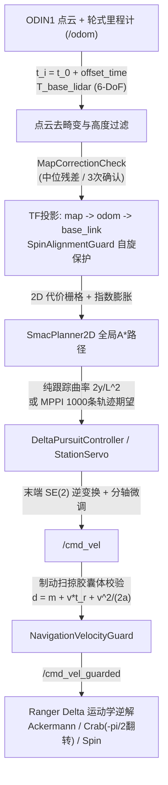

# `project_slam` 导航系统数学与算法原理解析

本文面向具有**高等数学、线性代数、概率论**基础但尚未系统接触移动机器人导航算法开发的读者，对照 `project_slam` 的真实代码实现，完整推导本系统从传感器标定、点云配准定位、全局/局部轨迹规划、到全向底盘控制与末端精密泊车的每一条核心公式，不省略关键推导步骤。

---

## 第 1 章 数学基础：从大一数学到机器人几何

移动机器人算法开发本质上是用线性代数描述**空间位置与朝向**，用多元微积分求**最优解的迭代步长**，用概率论处理**传感器噪声与退化**。

### 1.1 线性代数：$SO(n)$、$SE(n)$ 与刚体变换

#### 1.1.1 二维旋转矩阵 $SO(2)$ 与三维旋转矩阵 $SO(3)$

在平面内，将坐标系 $\{B\}$ 的基向量逆时针旋转角度 $\theta$，某一点 $p_B = [x_B, y_B]^T$ 在参考系 $\{A\}$ 中的坐标满足线性叠加：
$$p_A = x_B \begin{bmatrix} \cos\theta \\ \sin\theta \end{bmatrix} + y_B \begin{bmatrix} -\sin\theta \\ \cos\theta \end{bmatrix} = \underbrace{\begin{bmatrix} \cos\theta & -\sin\theta \\ \sin\theta & \cos\theta \end{bmatrix}}_{R(\theta) \in SO(2)} \begin{bmatrix} x_B \\ y_B \end{bmatrix}$$

所有 $n$ 维旋转矩阵构成特殊正交群 $SO(n)$，满足两个核心代数性质：
1. **正交性**：$R^T R = R R^T = I \implies R^{-1} = R^T$（求逆只需转置）。
2. **保手性/保长度**：$\det(R) = +1$，且 $\|Rp\|_2^2 = p^T R^T R p = \|p\|_2^2$。

三维空间中的旋转通常用三种等价形式表达，代码中经常互相转换：
- **旋转矩阵** $R \in \mathbb{R}^{3\times 3}$：直接参与矩阵乘法，无奇异性，但有 9 个数却只有 3 个自由度。
- **欧拉角 $(\phi, \theta, \psi)$（Roll-Pitch-Yaw）**：绕 $X$ 轴滚转（Roll $\phi$）、绕 $Y$ 轴俯仰（Pitch $\theta$）、绕 $Z$ 轴偏航（Yaw $\psi$）。在 ROS 常用的定轴外旋 `XYZ`（等价于随动内旋 `ZYX`）约定下：
  $$R = R_z(\psi) R_y(\theta) R_x(\phi)$$
  本系统标定与定位节点中使用的 `scipy.spatial.transform.Rotation.from_euler('xyz', [roll, pitch, yaw])` 正是 `extrinsic xyz` 顺序，即 $R = R_z(\text{yaw}) R_y(\text{pitch}) R_x(\text{roll})$。
- **单位四元数 $q = (q_x, q_y, q_z, q_w)$**（满足 $\|q\|_2 = 1$）：无万向节锁，便于插值。ROS TF 消息中储存四元数，由绕 $Z$ 轴纯平面旋转 $\psi$ 构造四元数为：
  $$q_x = 0,\quad q_y = 0,\quad q_z = \sin\frac{\psi}{2},\quad q_w = \cos\frac{\psi}{2}$$
  对应 [`odin_localization.py`](../src/odin_nav_sim/scripts/odin_localization.py#L184-L185) 与 [`station_observation.py`](../src/odin_nav_sim/scripts/station_observation.py#L74)。而从四元数反解平面偏航角 $\psi$ 的公式为：
  $$\psi = \operatorname{atan2}\!\Big(2(q_w q_z + q_x q_y),\; 1 - 2(q_y^2 + q_z^2)\Big)$$
  对应 [`solve_calibration.py`](../scripts/calib/solve_calibration.py#L170)。

#### 1.1.2 齐次变换矩阵 $SE(3)$ 与坐标链传递

若坐标系 $\{B\}$ 相对 $\{A\}$ 不仅有旋转 $R_{AB}$，原点还有平移 $t_{AB} \in \mathbb{R}^3$，则 $\{B\}$ 中一点 $p_B$ 变换到 $\{A\}$ 为：
$$p_A = R_{AB} p_B + t_{AB}$$

这个仿射变换无法直接写成 $3\times 3$ 矩阵连乘。引入第 4 维齐次坐标 $\tilde{p} = [x, y, z, 1]^T$，可统一为线性矩阵乘法 $SE(3)$：
$$\begin{bmatrix} p_A \\ 1 \end{bmatrix} = \underbrace{\begin{bmatrix} R_{AB} & t_{AB} \\ \mathbf{0}^T & 1 \end{bmatrix}}_{T_{AB} \in SE(3)} \begin{bmatrix} p_B \\ 1 \end{bmatrix}$$

由此立即得到**坐标链法则**（下标相邻可消去）与**逆变换闭式解**：
$$T_{AC} = T_{AB} T_{BC},\qquad T_{BA} = T_{AB}^{-1} = \begin{bmatrix} R_{AB}^T & -R_{AB}^T t_{AB} \\ \mathbf{0}^T & 1 \end{bmatrix}$$

> **验证**：$T_{AB} T_{AB}^{-1} = \begin{bmatrix} R_{AB} R_{AB}^T & -R_{AB} R_{AB}^T t_{AB} + t_{AB} \\ \mathbf{0}^T & 1 \end{bmatrix} = \begin{bmatrix} I & \mathbf{0} \\ \mathbf{0}^T & 1 \end{bmatrix}$。

在二维平面 $SE(2)$ 中，位姿记作 $\xi = [x, y, \psi]^T$。两个位姿 $\xi_a = [x_a, y_a, \psi_a]^T$ 与 $\xi_b = [x_b, y_b, \psi_b]^T$ 的**合成**（`compose_se2`）与**相对位姿**（`relative_pose`，即 $\xi_a^{-1} \circ \xi_b$）分别由矩阵乘法与矩阵求逆直接展开得到：
$$\xi_a \circ \xi_b = \begin{bmatrix} x_a + \cos\psi_a \cdot x_b - \sin\psi_a \cdot y_b \\ y_a + \sin\psi_a \cdot x_b + \cos\psi_a \cdot y_b \\ \operatorname{wrap}(\psi_a + \psi_b) \end{bmatrix},\qquad \xi_a^{-1} \circ \xi_b = \begin{bmatrix} R(-\psi_a)\begin{bmatrix} x_b - x_a \\ y_b - y_a \end{bmatrix} \\ \operatorname{wrap}(\psi_b - \psi_a) \end{bmatrix}$$
其中 $\operatorname{wrap}(\alpha) = \operatorname{remainder}(\alpha, 2\pi) \in [-\pi, \pi]$。这与 [`solve_calibration.py`](../scripts/calib/solve_calibration.py#L73-L79) 和 [`parking_keyframe.py`](../src/odin_nav_sim/scripts/parking_keyframe.py#L14-L18) 完全一致。

#### 1.1.3 旋转微扰与矩阵求导：点坐标对 $SE(2)$ 位姿的雅可比矩阵

优化算法中需要求点云变换 $q_i(\xi) = R(\psi)p_i + t$ 对位姿增量 $\Delta\xi = [\Delta x, \Delta y, \Delta\psi]^T$ 的一阶偏导（雅可比矩阵）。

当对当前已变换点 $m_i = [m_{ix}, m_{iy}, m_{iz}]^T$ 施加一个围绕世界原点或参考中心 $[x, y]^T$ 的极小旋转增量 $\delta\psi \to 0$ 时，利用一阶泰勒展开 $\cos(\delta\psi) \approx 1,\; \sin(\delta\psi) \approx \delta\psi$：
$$\begin{bmatrix} m'_{ix} \\ m'_{iy} \end{bmatrix} = \begin{bmatrix} x \\ y \end{bmatrix} + \begin{bmatrix} 1 & -\delta\psi \\ \delta\psi & 1 \end{bmatrix} \begin{bmatrix} m_{ix} - x \\ m_{iy} - y \end{bmatrix} + \begin{bmatrix} \delta x \\ \delta y \end{bmatrix} = \begin{bmatrix} m_{ix} \\ m_{iy} \end{bmatrix} + \begin{bmatrix} \delta x - (m_{iy} - y)\delta\psi \\ \delta y + (m_{ix} - x)\delta\psi \end{bmatrix}$$

记力臂 $r_x = m_{ix} - x,\; r_y = m_{iy} - y$，则点位置对 $[\delta x, \delta y, \delta\psi]^T$ 的偏导矩阵为：
$$\frac{\partial q_i}{\partial \xi} = \begin{bmatrix} 1 & 0 & -r_y \\ 0 & 1 & r_x \\ 0 & 0 & 0 \end{bmatrix}$$

> **工程细节**：注意 [`ParkingKeyframe::fit`](../src/odin_nav_sim/scripts/parking_keyframe.py#L64-L68) 和 `local_experiments/repeat_test/prior_map_matcher.py` 中对第 3 列旋转项除以 2（`jac[:, 2] /= 2`），相当于把角增量变量无量纲化为“2 米臂长处的切向弧长位移（单位：米）”，从而让平移和旋转的雅可比矩阵列范数处于同一数量级，避免病态条件数。求解后再将 $\Delta\psi$ 除以 2 还原为弧度。

---

### 1.2 高等数学：非线性最小二乘与高斯-牛顿法 (Gauss-Newton)

大量 SLAM 配准和标定问题都归结为最小化 $N$ 个非线性残差 $r_i(\theta)$ 的平方和：
$$\min_{\theta \in \mathbb{R}^d} E(\theta) = \frac{1}{2}\sum_{i=1}^{N} \big(r_i(\theta)\big)^2 = \frac{1}{2} \| \mathbf{r}(\theta) \|_2^2$$

由于 $r_i(\theta)$ 含有 $\sin/\cos$ 或最近邻关联，通常没有闭式解，只能从初值 $\theta_0$ 出发迭代更新 $\theta_{k+1} = \theta_k + \Delta\theta$：

1. **一阶多元泰勒展开**：在当前点 $\theta_k$ 附近近似线性化残差向量：
   $$\mathbf{r}(\theta_k + \Delta\theta) \approx \mathbf{r}(\theta_k) + J(\theta_k)\Delta\theta,\qquad \text{其中 } J_{ij} = \frac{\partial r_i}{\partial \theta_j}\Big|_{\theta_k} \in \mathbb{R}^{N\times d}$$
2. **代入目标函数**：
   $$\hat{E}(\Delta\theta) = \frac{1}{2} (\mathbf{r} + J\Delta\theta)^T (\mathbf{r} + J\Delta\theta) = \frac{1}{2}\mathbf{r}^T\mathbf{r} + \mathbf{r}^T J\Delta\theta + \frac{1}{2}\Delta\theta^T (J^T J)\Delta\theta$$
3. **多元极值必要条件（梯度为零）**：对 $\Delta\theta$ 求偏导并令其为 $\mathbf{0}$：
   $$\nabla_{\Delta\theta}\hat{E} = J^T \mathbf{r} + (J^T J)\Delta\theta = \mathbf{0} \implies \underbrace{(J^T J)}_{H \text{ (Gauss-Newton海森)}} \Delta\theta = -J^T \mathbf{r}$$

**为何比牛顿法更实用？** 二阶真实海森是 $J^T J + \sum_i r_i \nabla^2 r_i$，计算二阶导代价极高且不保证正定；而高斯-牛顿近似 $H = J^T J$ **恒为对称半正定矩阵**，且只需要一阶导数 $J$。

**代码如何数值求解该方程？** 直接求 $(J^T J)^{-1}$ 会使矩阵条件数平方放大（$\kappa(J^T J) = \kappa(J)^2$），容易数值崩溃。实际代码（如 `np.linalg.lstsq(J, -r)`）直接对雅可比做**奇异值分解 (SVD)**：
$$J = U \Sigma V^T \implies \Delta\theta = -V \Sigma^+ U^T \mathbf{r}$$
其中特征值满足 $\sigma_i(J)^2 = \lambda_i(J^T J)$，既保证了高精度，又直接给出衡量方程病态程度的奇异值比 $\sigma_{\min} / \sigma_{\max}$。

---

### 1.3 概率论：极大似然估计、信息矩阵退化与 IRLS 鲁棒核

#### 1.3.1 从概率论到加权最小二乘与海森矩阵几何意义

假设每次观测残差服从独立的零均值高斯分布 $r_i(\theta) \sim \mathcal{N}(0, \sigma_i^2)$，则给定参数 $\theta$ 时产生所有观测的似然函数为：
$$P(\mathbf{r} \mid \theta) = \prod_{i=1}^N \frac{1}{\sqrt{2\pi}\sigma_i} \exp\!\left(-\frac{r_i(\theta)^2}{2\sigma_i^2}\right)$$

取负对数极大似然（NLL）等价于最小化加权平方和：
$$-\ln P(\mathbf{r} \mid \theta) = \text{const} + \frac{1}{2} \sum_{i=1}^N \left(\frac{r_i(\theta)}{\sigma_i}\right)^2 = \frac{1}{2} \mathbf{r}^T W \mathbf{r},\qquad W = \operatorname{diag}(1/\sigma_i^2)$$

其后验参数估计的**协方差矩阵**近似等于信息矩阵（即加权高斯-牛顿海森矩阵）的逆：
$$\Sigma_\theta \approx (J^T W J)^{-1} = H^{-1}$$

对对称矩阵 $H$ 做特征值分解 $H = Q \Lambda Q^T$，第 $j$ 个特征方向 $q_j$ 上的方差满足：
$$\operatorname{Var}(\theta \cdot q_j) \approx \frac{1}{\lambda_j(H)}$$
- 若某个特征值 $\lambda_{\min}(H) \to 0$，则该方向上的方差 $\to \infty$——这正是点云配准中**几何退化**（例如长直走廊沿走廊方向没有任何法向约束）的严格概率定义。

#### 1.3.2 迭代重加权最小二乘 (IRLS) 与 `soft_l1` 鲁棒核函数

普通最小二乘对单个外点（行人、误匹配）极其敏感，因为梯度 $\propto r_i$ 随误差线性暴涨。在重尾误差分布假设下，需用鲁棒损失 $\rho(r_i)$ 替代二次损失 $\frac{1}{2}r_i^2$：
$$\min_\theta \sum_{i=1}^N \rho\big(r_i(\theta)\big)$$

求导得 $\sum_i \frac{\partial \rho(r_i)}{\partial r_i} \frac{\partial r_i}{\partial \theta} = 0$。令等效权重函数 $w(r_i)^2 = \frac{\rho'(r_i)}{r_i}$，则极值条件写成：
$$\sum_{i=1}^N \underbrace{w(r_i)^2}_{\text{冻结权重}} r_i(\theta) \frac{\partial r_i}{\partial \theta} = 0$$
于是每一步只需将标准残差和雅可比各自乘以标量 $w_i = \sqrt{\rho'(r_i)/r_i}$，就转化为了普通的最小二乘！

在 [`ParkingKeyframe::fit`](../src/odin_nav_sim/scripts/parking_keyframe.py#L65)、`local_experiments/repeat_test/prior_map_matcher.py` 与 [`solve_calibration.py`](../scripts/calib/solve_calibration.py#L125) 中，使用的均是截断型降权公式：
$$w_i = \sqrt{\frac{\delta}{\max(|r_i|, \delta)}}$$
我们来验证它的等效损失行为：
- **内点区间（$|r_i| \le \delta$）**：$w_i = 1$，等效梯度 $w_i^2 r_i = r_i$，等效损失为标准二次型 $\frac{1}{2} r_i^2$，收敛快、无偏；
- **外点区间（$|r_i| > \delta$）**：$w_i^2 = \frac{\delta}{|r_i|}$，等效梯度 $w_i^2 r_i = \delta \cdot \operatorname{sign}(r_i)$ **被钳位为常数 $\pm\delta$**，等效损失转为 $L_1$ 绝对值线性增长，外点无法主导整体拟合。

此外在标定与墙面拟合中也直接调用了 `scipy.optimize.least_squares(..., loss='soft_l1', f_scale=δ)`，其损失函数为：
$$\rho_{\text{soft\_l1}}(r) = 2\delta^2 \left(\sqrt{1 + (r/\delta)^2} - 1\right)$$
当 $|r| \ll \delta$ 时泰勒展开为 $r^2$，当 $|r| \gg \delta$ 时渐近于 $2\delta |r|$，且二阶光滑可导。

---

### 1.4 PCA 主成分分析与局部点云法向量提取

点到面配准需要每个点所在局部表面的法向量。设点 $p$ 的 $k$ 个最近邻为 $\{q_1, \dots, q_k\}$，局部质心 $\bar{q} = \frac{1}{k}\sum_{j=1}^k q_j$。

要找一个单位法向量 $n$（$\|n\|_2 = 1$），使所有邻域点到过质心平面的垂直距离平方和最小：
$$\min_{\|n\|_2=1} \sum_{j=1}^k \big(n^T(q_j - \bar{q})\big)^2 = n^T \left[\sum_{j=1}^k (q_j - \bar{q})(q_j - \bar{q})^T\right] n = n^T M n$$

构造拉格朗日函数 $\mathcal{L}(n, \lambda) = n^T M n - \lambda(n^T n - 1)$，对 $n$ 求导并令其为零：
$$\nabla_n \mathcal{L} = 2Mn - 2\lambda n = 0 \implies M n = \lambda n$$

将 $M n = \lambda n$ 左乘 $n^T$ 得最小目标函数值恰等于特征值 $\lambda$！由于 $M$ 是实对称半正定矩阵，其特征值按升序排列 $0 \le \lambda_0 \le \lambda_1 \le \lambda_2$：
- **最小特征值 $\lambda_0$ 对应的单位特征向量 $v_0$ 即为最优局部平面法向量 $n$**（方向沿点云方差最小、最“扁平”的法线轴）；
- $\lambda_1, \lambda_2$ 度量点云在平面内的切向展开程度。

代码直接据此识别非地面结构平面：
- [`ParkingKeyframe.__init__`](../src/odin_nav_sim/scripts/parking_keyframe.py#L44-L49) 取 $k=16$，要求：
  $$\lambda_0 < 0.20 \lambda_1 \quad \text{且} \quad |n_z| < 0.80$$
  前一项排除角点/散乱噪点/厚杂波墙，后一项过滤水平地面与天花板（$|n_z| \ge 0.80$ 对应法向与竖直 $Z$ 轴夹角小于 $\arccos 0.8 \approx 36.9^\circ$）。
- [`solve_calibration.py`](../scripts/calib/solve_calibration.py#L56-L69) 取 $k=14$，采用归一化平面度判据 $\frac{\lambda_1 - \lambda_0}{\lambda_2} > 0.15$，并通过检查 $n \cdot p > 0$ 将所有法向统一朝向传感器原点定向。

---

## 第 2 章 传感器时空基准与 6-DoF 外参标定算法

### 2.1 TF 坐标变换树与全局定位投影推导

系统运行两套相互隔离、通过标定外参桥接的坐标树：
1. **底盘编码器树**：`odom -> base_link -> lidar`
   - `odom -> base_link`：由底盘反馈节点发布，高频（约 50 Hz）、局部非常平滑但长距离会因打滑累计漂移。
   - `base_link -> lidar`：即 6-DoF 静态安装外参 $T_{\text{base}\leftarrow\text{lidar}}$（由当前标定结果冻结为 `x=0.1754 m, y=0.0025 m, z=1.1241 m, roll=-0.00085 rad, pitch=+0.01325 rad, yaw=-0.02631 rad`）。
2. **ODIN SLAM 驱动私有树**（[`real_navigation.launch.py`](../src/odin_nav_sim/launch/real_navigation.launch.py#L82) 重映射到 `/odin1/tf`）：`odin_map -> odin_odom -> lidar`。

Nav2 规划与控制要求在全局平面提供 `map -> odom` 连续变换。定位节点 [`map_to_odom`](../src/odin_nav_sim/scripts/odin_localization.py#L29-L36) 的推导链条极为关键：

**错误直觉**：直接把激光雷达的三维位姿水平分量当作底盘中心位姿，或在三维平移前忘了去除传感器俯仰/横滚安装角。当雷达高度为 $z \approx 1.12\text{ m}$ 时，即使存在 $1.5^\circ$ 倾角，投影误差也达到 $1.12 \sin(1.5^\circ) \approx 2.9\text{ cm}$！

**严格推导**：
1. 先将 ODIN 输出的三维雷达位姿逆向还原回三维物理旋转中心 `base_link`：
   $$T_{\text{map}\leftarrow\text{base}}^{(3\text{D})} = T_{\text{map}\leftarrow\text{odin\_map}} \cdot T_{\text{odin\_map}\leftarrow\text{lidar}} \cdot \big(T_{\text{base}\leftarrow\text{lidar}}\big)^{-1}$$
2. 提取其二维平面位置与偏航角 $(x, y, \psi)$ 构造平面基座帧 $T_{\text{map}\leftarrow\text{base}}^{(2\text{D})} = \big(R_z(\psi),\, [x, y, 0]^T\big)$（抹平微小 Z 漂移和俯仰/横滚）。
3. 为保证在 ODIN 更新间隙仍能利用高频平滑轮式里程计，必须反算出慢漂移修正量 `map -> odom`：
   $$T_{\text{map}\leftarrow\text{base}}^{(2\text{D})} = T_{\text{map}\leftarrow\text{odom}} \cdot T_{\text{odom}\leftarrow\text{base}} \implies T_{\text{map}\leftarrow\text{odom}} = T_{\text{map}\leftarrow\text{base}}^{(2\text{D})} \cdot \big(T_{\text{odom}\leftarrow\text{base}}\big)^{-1}$$

由于 TF 查询时需保证历史对齐平滑，`odin_localization.py` 在发布时加上了参数 `tf_stamp_lead = 0.30 s` 的时间戳超前量，允许 Nav2 在 0.3 s 内直接复合最新的高频轮式里程计使用而不报外推超时。

---

### 2.2 静止多点云地面整平（Roll, Pitch, Z 求解）

[`solve_calibration.py`](../scripts/calib/solve_calibration.py#L29-L44) 从静止点云的近处地面区域拟合平面方程：
$$z = a x + b y + c_z \iff a x + b y - z + c_z = 0$$

利用 `soft_l1` 非线性最小二乘求得 $(a, b, c_z)$。由此立即读出朝上的未归一化法向 $[-a, -b, 1]^T$，归一化得单位地面法向（在激光雷达坐标系下）：
$$n = \begin{bmatrix} n_x \\ n_y \\ n_z \end{bmatrix} = \frac{1}{\sqrt{a^2 + b^2 + 1}} \begin{bmatrix} -a \\ -b \\ 1 \end{bmatrix}$$

要求旋转矩阵 $R_{\text{rp}} = R_y(\theta) R_x(\phi)$ 将雷达系向量转到水平 `base_link` 系的竖直上方向 $e_z = [0, 0, 1]^T$，等价于 $R_{\text{rp}}^T e_z = n$（即 $R_x(\phi)^T R_y(\theta)^T e_z = n$）：
$$R_x(-\phi) R_y(-\theta) \begin{bmatrix} 0 \\ 0 \\ 1 \end{bmatrix} = \begin{bmatrix} 1 & 0 & 0 \\ 0 & \cos\phi & \sin\phi \\ 0 & -\sin\phi & \cos\phi \end{bmatrix} \begin{bmatrix} -\sin\theta \\ 0 \\ \cos\theta \end{bmatrix} = \begin{bmatrix} -\sin\theta \\ \sin\phi\cos\theta \\ \cos\phi\cos\theta \end{bmatrix} = \begin{bmatrix} n_x \\ n_y \\ n_z \end{bmatrix}$$

> 注：外旋 `xyz` 即 $R_{\text{rp}} = R_y(\theta) R_x(\phi)$ 时，$R_{\text{rp}} n = e_z \implies n = R_x(-\phi) R_y(-\theta) e_z$。对照上面向量每行分量，立即无歧义反解出：
$$\phi = \text{roll} = \operatorname{atan2}(n_y, n_z),\qquad \theta = \text{pitch} = \operatorname{atan2}\!\left(-n_x,\, \sqrt{n_y^2 + n_z^2}\right)$$

同时点云平面方程重写为 $n^T p + c_z n_z = 0$，原点（雷达光心）到地面的有向垂直距离（即安装高度）为：
$$\text{sensor\_z} = -c_z n_z$$

对 6 个不同位置的静止点云分别求解并取中位数，可抵消局部地板波浪起伏。整平后所有墙面点只需变换 $p_{\text{level}} = R_{\text{rp}} p_{\text{raw}} + [0, 0, \text{sensor\_z}]^T$ 即可垂直于地面。

---

### 2.3 自旋定旋转中心 + 直行定偏航（6-DoF 全外参联合标定）

仅靠静止拍照和卷尺无法精准测定光学原点相对于底盘机械旋转中心的位置与雷达自身前向偏航角。[`solve_calibration.py`](../scripts/calib/solve_calibration.py#L244-L422) 通过**两个正交运动激励**完成闭合解算：

#### 第一步：原地自旋求解雷达相对旋转中心偏移 $r_L$

机器人在原地仅做旋转模式（`SPIN`）转动至多角度 $\psi_k$。设物理旋转中心在世界房间系下的固定坐标为 $c_W \in \mathbb{R}^2$；在以某个刚体偏航为 $\psi_k$ 的传感器局部系中，传感器原点相对旋转中心的矢量固定为 $r_L = [r_{Lx}, r_{Ly}]^T$。

根据刚体运动学关系，传感器原点在世界系下的轨迹点 $p_{L,k} = [p_{Lx,k}, p_{Ly,k}]^T$ 必满足圆周方程：
$$p_{L,k} = c_W + R(\psi_k) r_L \iff \begin{bmatrix} 1 & 0 & \cos\psi_k & -\sin\psi_k \\ 0 & 1 & \sin\psi_k & \cos\psi_k \end{bmatrix} \begin{bmatrix} c_{Wx} \\ c_{Wy} \\ r_{Lx} \\ r_{Ly} \end{bmatrix} = \begin{bmatrix} p_{Lx,k} \\ p_{Ly,k} \end{bmatrix}$$

**工程中的两个关键数学处理**（第 334–358 行）：
1. **退化帧剔除**：对于多段旋转配准生成的帧，先算其局部点对平面配准的平移海森 $H_{xy} = \sum n_{xy} n_{xy}^T$ 的最小/最大特征值比。仅当非退化条件数 $\lambda_{\min}/\lambda_{\max} \ge 0.08$ 时才纳入拟合。
2. **分段圆心 + 鲁棒估计**：由于机械齿轮间隙或轮胎微滑移，不同起停旋转段（$s \in \{0, 1, 2\}$）的实际物理圆心会有几毫米偏移，而雷达刚体臂长 $r_L$ 绝对不变。因此对 3 段分别设未知圆心 $c_W^{(0)}, c_W^{(1)}, c_W^{(2)}$ 但**共享同一个 $r_L$**，再用 `soft_l1`（$f_{\text{scale}} = 5\text{ mm}$）求解 8 维线性方程组。

#### 第二步：直行运动求解安装偏航角 `sensor_yaw` 与平移外参 `(sensor_x, sensor_y)`

旋转标定求出的 $r_L$ 是表达在**激光雷达自身 $X_L, Y_L$ 轴向**下的，尚未对齐车辆真正的正向运动轴 $+X_{\text{base}}$。

让车辆舵轮回正做前向直行运动。对起点与终点点云建立廊道拼接图并精准配准，测得雷达自身在起点雷达系 $L_{\text{ds}}$ 中的位移 $(\Delta x_L, \Delta y_L)$ 与微小航向漂移 $\Delta\psi_{\text{drv}}$。利用旋转中心的偏移公式：
$$c_{\text{end}} = p_{\text{end}} - R(\Delta\psi_{\text{drv}}) r_L,\qquad c_{\text{start}} = p_{\text{start}} - I r_L$$
两式相减得到**旋转中心真实的物理位移矢量**（已消除小偏航自旋引起的传感器杠杆附加摆动）：
$$\Delta c_L = \Delta p_L - \big(R(\Delta\psi_{\text{drv}}) - I\big) r_L$$

若直行过程接近常曲率圆弧（转过小角度 $\Delta\psi_{\text{drv}}$），由初等圆弧几何定理，弦向量 $\Delta c_L$ 的方向角恰等于起始切线方向角与终点切线方向角的平均值：
$$\theta_{\text{chord}} = \operatorname{atan2}(\Delta c_{Ly}, \Delta c_{Lx}) = \theta_{\text{start}} + \frac{\Delta\psi_{\text{drv}}}{2}$$
从而车体真正前进轴 $+X_{\text{base}}$ 在雷达系中的方位角为：
$$\alpha_{\text{chassis in L}} = \theta_{\text{chord}} - \frac{\Delta\psi_{\text{drv}}}{2}$$
将坐标由雷达系转到车体系的偏航角外参恰为其负值：
$$\text{sensor\_yaw} = -\alpha_{\text{chassis in L}},\qquad \begin{bmatrix} \text{sensor\_x} \\ \text{sensor\_y} \end{bmatrix} = R(\text{sensor\_yaw}) \cdot r_L$$
对应 [`solve_calibration.py`](../scripts/calib/solve_calibration.py#L403-L413)。

> **验证与尺量基准关系**：同样把人工卷尺测得的车头中心标志 $F$ 与车尾中心标志 $R$ 的中点代入圆心模型，求解得人工胶带中点距物理旋转中心约 $25.1\text{ cm}$。因此今后任何卷尺真值验收必须先由 $R \to F$ 计算车身朝向角，再把中点平移回物理旋转中心对比（否则仅 $5^\circ$ 车身转角误差就会在胶带中点放大出 $25.1\sin 5^\circ \approx 2.2\text{ cm}$ 的虚假位置误差）。

---

### 2.4 点云时间语义与运动畸变补偿（Deskew）

激光雷达在旋转扫掠过程中并非“瞬间拍照”，一帧扫描跨越接近 $100\text{ ms}$。查看 [`host_sdk_sample.h`](../src/odin_ros_driver/include/host_sdk_sample.h#L688)：每个点携带字段 `offset_time`（$\Delta t_i \in [0.000, 94.368]\text{ ms}$，按垂直扫描行组从下往上单调递增）。

设帧头时间戳为 $t_0$，任一点真实采样时刻为 $t_i = t_0 + \Delta t_i$。当底盘以角速度 $\omega_z$ 自旋时，点 $p_i$ 实际是在雷达旋转了角度 $\delta\theta_i = \int_{t_0}^{t_0+\Delta t_i} \omega_z(\tau)\,d\tau$ 时采到的，因此必须投影回帧头基准时刻 $t_0$：
$$p_i^{\text{deskew}}(t_0) = R\big(\delta\theta_i\big) \, p_i^{\text{raw}}$$

我们在实验一中正反自旋实测验证了这一模型的符号与基准：$t_i = t_0 + \Delta t_i$（正号）使 `ICP_yaw - odom_yaw` 的偏差在 `+0.151 rad/s` 下从 `+0.445°` 降至 `+0.012°`，在 `-0.152 rad/s` 下从 `-0.432°` 降至 `-0.052°`；而若反向减时间或对齐到帧尾时刻，偏差反而翻倍到 `±0.84°`。

---

## 第 3 章 点云匹配、重定位确认与几何退化门限

### 3.1 Point-to-Plane ICP 完整目标函数与雅可比推导

在三维或平面环境中，配准两帧点云的经典方法有两种：
1. **Point-to-Point ICP**：直接最小化两点欧氏距离 $\sum \|q_i(\xi) - target_i\|_2^2$。缺点是哪怕沿一面长墙平行微移，对应最近点也会像“齿轮咬合”一样死锁在离散体素采样点上，收敛缓慢且误差大。
2. **Point-to-Plane ICP**（本系统 [`ParkingKeyframe`](../src/odin_nav_sim/scripts/parking_keyframe.py)、`local_experiments/repeat_test/prior_map_matcher.py` 与 [`StationWalls`](../src/odin_nav_sim/scripts/station_walls.py) 均采用此法）：只惩罚当前点 $q_i(\xi)$ **沿着参考平面单位法线 $n_i$ 方向到目标切平面的垂直距离**：
   $$r_i(\xi) = n_i^T \big(q_i(\xi) - target_i\big)$$

利用 1.1.3 节导出的点坐标对 $SE(2)$ 增量的雅可比 $\frac{\partial q_i}{\partial \xi}$ 和链式法则，直接得到第 $i$ 行的 3 维雅可比行向量：
$$J_i = n_i^T \frac{\partial q_i}{\partial \xi} = \begin{bmatrix} n_{ix} & n_{iy} & 0 \end{bmatrix} \begin{bmatrix} 1 & 0 & -r_{iy} \\ 0 & 1 & r_{ix} \\ 0 & 0 & 0 \end{bmatrix} = \Big[\, n_{ix},\; n_{iy},\; (r_{ix} n_{iy} - r_{iy} n_{ix}) \,\Big]$$
其中 $r_{ix} = q_{ix} - x,\; r_{iy} = q_{iy} - y$。注意 $(r_x n_y - r_y n_x)$ 恰是二维力臂 $\mathbf{r} \times \mathbf{n}$ 的叉积标量——几何意义极其直观：法线垂直于旋转方向力臂时对旋转角最敏感，法线过旋转中心时旋转角雅可比为 0！

再用 1.3.2 节的 IRLS 权重 $w_i$ 乘到 $J_i$ 与 $-r_i$ 上，用 `lstsq` 求解更新量 $\Delta\xi$ 并迭代至收敛（步长 $< 0.2\sim 1\text{ mm}, < 0.0001\sim 0.0005\text{ rad}$）。

---

### 3.2 多初值歧义检查与 Hessian 弱几何退化门限

单个 ICP 收敛并不代表位姿正确——对称走廊、重复工位往往会产生多个同样低残差的局部极小值（多峰后验）。因此 [`ParkingKeyframe::check`](../src/odin_nav_sim/scripts/parking_keyframe.py#L90-L113) 和 `local_experiments/repeat_test/prior_map_matcher.py` 对每次配准设置了**四道硬数学门限**：

1. **多初值一致（排多峰歧义 `ambiguous_fit`）**：从预测初值 $\xi_{\text{guess}}$ 分别偏置 $\{-6^\circ, 0^\circ, +6^\circ\}$ 独立运行三次迭代；要求全部 3 次收敛，且两两收敛结果之差满足平面距离 $\le 2.5\text{ cm}$、航向差 $\le 2^\circ$。
2. **Hessian 几何可观度（排通道退化 `weak_geometry`）**：计算尺度归一后加权海森矩阵 $H = (W^{1/2} J)^T (W^{1/2} J)$ 对应雅可比奇异值比：
   $$\frac{\sigma_{\min}}{\sigma_{\max}} \ge 0.03$$
   对应概率方差界：最弱约束方向不确定度相对于最强方向不超过 $\approx 1/0.03 \approx 33$ 倍（代码中工位双墙更严，[`StationWalls::match`](../src/odin_nav_sim/scripts/station_walls.py#L106) 要求 $> 0.08$）。
3. **重叠率门限（排环境遮挡或地图过时 `low_overlap`）**：
   - `ParkingKeyframe` 要求 8 cm 容差下点云重合适配比例 `source_overlap_8cm >= 0.65`（全图模式）或双向 `bilateral_overlap_8cm >= 0.65`（局部锚点模式）；
   - `PriorMapMatcher` 额外要求非地面结构点法向平行且 $< 8\text{ cm}$ 的比例 `structural_overlap >= 0.50`。
4. **新息门限（排飞点跳变 `large_innovation`）**：解算结果相对预测初值的偏移不得超过 $(0.35\text{ m}, 20^\circ)$。

> **为什么此前 `1.pcd` 离线回放出现大量拒绝？（结合实验二分析）**：
> 1. 历史 ODIN 导出的 `1.pcd` 在高度 $z = 2.00\text{ m}$ 处被截顶，导致实车 31% 的高层观测点在先验图中完全无对应；
> 2. 即使裁剪高度后，因旧图未去畸变/多趟配准误差，墙面厚度较大（部分墙面不满足平面性判据 $\lambda_0 < 0.20\lambda_1$），使得 `PriorMapMatcher` 在建树时将 68% 的墙面区域筛除，造成 `structural_overlap` 仅 `0.318 < 0.50` 而拒收。这从数学上解释了为何下一步需要构建薄壁精准静态图并引入基于信息矩阵的 4-DoF VGICP/GICP。

---

### 3.3 在线重定位跳变过滤：[`MapCorrectionCheck`](../src/odin_nav_sim/scripts/odin_reference_cloud.py#L72-L133) 与 [`SpinAlignmentGuard`](../src/odin_nav_sim/scripts/odin_spin_guard.py#L17-L69)

即使离线点云精准，在线定位运行中仍会出现两类典型风险：
1. **ODIN 后台回环瞬间大幅修正 `odin_map -> odin_odom`**。若直接透传给控制环，机械臂/底盘规划器会看见目标瞬间平移而猛打舵。
   [`MapCorrectionCheck`](../src/odin_nav_sim/scripts/odin_reference_cloud.py#L72-L133) 对候选修正量 $T_{\text{cand}}$ 在实时扫到的 `lidar` 点上与已接受的先验 PCD（体素 `2.8 cm`）做最近邻打分（中位距离 $d_{\text{med}}$ 与 5 cm 内点比例 $r_{5\text{cm}}$）：
   - 正常需满足绝对好度 $d_{\text{med}} \le 4.5\text{ cm}$ 且 $r_{5\text{cm}} \ge 55\%$；
   - 新候选只有**连续 3 帧稳定一致**且相对于原接受修正显著改善（$d_{\text{med}}$ 缩小 $\ge 0.6\text{ cm}$ 且 $r_{5\text{cm}}$ 提高 $\ge 3\%$）才切换 `self.accepted`；若无支持超过 $0.7\text{ s}$ 则置空停止输出位姿。

2. **原地自旋期间 SLAM 位置抖动**。Ranger Delta 在原地旋转时，轮式半径较小且转向无大滑移，反而激光雷达受点云畸变与视野遮挡变化容易出现中心平移“晃动”。
   [`SpinAlignmentGuard`](../src/odin_nav_sim/scripts/odin_spin_guard.py#L17-L69) 状态机：
   - 一旦检测到进入自旋（`mode == 2`, 线速 $\le 0.015\text{ m/s}$, 角速 $\ge 0.025\text{ rad/s}$），开启保护态：用纯轮式增量 $\Delta T_{\text{wheel}} = (T_{\text{wheel}}^{(k-1)})^{-1} T_{\text{wheel}}^{(k)}$ 外推预计位姿：
     $$T_{\text{pred}} = T_{\text{out}}^{(k-1)} \cdot \Delta T_{\text{wheel}}$$
   - **原地阶段 (`holding`)**：完全锁死位置纠偏（$\text{xy\_limit} = 0$），偏航只允许按极低限速 $0.04\text{ rad/s} \cdot \Delta t$ 向 ODIN 缓慢收敛；
   - **退出并直线行驶后 (`recovering`)**：仅随着行驶距离 $d$ 和时间 $\Delta t$ 按限幅速率逐步消化积累的位置/角度偏差 $\mathbf{e} = p_{\text{raw}} - p_{\text{pred}}$：
     $$\text{xy\_limit} = \min(0.025\,\Delta t,\; 0.125\,d),\qquad \text{yaw\_limit} = \min(0.10\,\Delta t,\; 0.30\,d)$$
     直到残余误差一次吸收完毕才回到正常透传态。

---

## 第 4 章 全局规划、路径跟踪控制与底盘运动学逆解

### 4.1 全局代价地图与 `SmacPlanner2D`

[`nav2_real.yaml`](../src/odin_nav_sim/config/nav2_real.yaml#L31-L156) 采用分辨率 $5\text{ cm}$ 的二维栅格地图。关键数学逻辑在于**代价膨胀层（Inflation Layer）**：
- 实测底盘外接圆半径不超过 $0.28\text{ m}$，配置中取安全圆半径 $r_{\text{robot}} = 0.30\text{ m}$，膨胀半径 $r_{\text{inf}} = 0.55\text{ m}$（局部 $0.50\text{ m}$）。
- 任一栅格中心到最近障碍物（体素层投影在身高 $0.12\text{ m} \sim 1.35\text{ m}$ 内标记）的欧氏距离记作 $d$：
  - 若 $d \le r_{\text{robot}}$：赋予**致命代价 254 (Lethal)**，圆心禁止落入；
  - 若 $r_{\text{robot}} < d \le r_{\text{inf}}$：赋予**内切圆外指数衰减代价值**（`cost_scaling_factor` $= \alpha = 3.5$）：
    $$C(d) = \operatorname{round}\!\Big(252 \cdot \exp\!\big(-\alpha (d - r_{\text{robot}})\big)\Big)$$
  这样 `SmacPlanner2D` 的启发式 A* 搜索在无狭缝逼迫时会自动贴近通道中轴线走低代价区，而非贴墙摩擦。

---

### 4.2 局部控制：Pure Pursuit 几何推导 vs MPPI 随机最优控制

系统通过 [`DeltaPursuitController`](../src/odin_nav_sim/src/delta_pursuit_controller.cpp) 统一封装，支持标准纯跟踪（RPP）和 `MPPIController` 两套路径跟踪内核，并在外层强加底盘阿克曼曲率物理硬约束。

#### 4.2.1 纯跟踪 (Pure Pursuit) 曲率公式严格推导

设车辆当前坐标系原点在后轴/旋转中心，车头朝向 $+x$。在全局路径上截取前视距离 $L$ 处的目标点，将其转换到当前车体系得坐标 $(x_L, y_L)$，满足 $L^2 = x_L^2 + y_L^2$。

假设我们只用一个恒定曲率圆弧（半径为 $R$）从原点 $(0,0)$ 且切线沿 $+x$ 轴出发，恰好经过前视点 $(x_L, y_L)$。圆心必在 $+y$ 轴上，坐标为 $(0, R)$。由圆方程写出约束：
$$(x_L - 0)^2 + (y_L - R)^2 = R^2$$
展开左边：
$$x_L^2 + y_L^2 - 2 R y_L + R^2 = R^2 \implies L^2 = 2 R y_L$$
立即得到圆弧曲率 $\kappa = 1/R$ 与期望角速度 $\omega_z = v_x \kappa$：
$$\kappa = \frac{2 y_L}{L^2},\qquad \omega_z = v_x \cdot \operatorname{clamp}(\kappa,\, -1/R_{\min},\; 1/R_{\min})$$
完全对应 [`delta_pursuit_controller.cpp`](../src/odin_nav_sim/src/delta_pursuit_controller.cpp#L272-L283)。

当路径偏航角 $\alpha_{\text{path}} = \operatorname{atan2}(y_L, x_L)$ 过大，以至于连最小转弯半径圆弧在距离 $L$ 内都无法掰正时——最大可达弦偏角满足弦长公式 $L = 2 R_{\min} \sin\alpha_{\max} \implies \alpha_{\text{feasible}} = \arcsin\min\!\left(1,\, \frac{L}{2 R_{\min}}\right)$——控制器自动切换到**原地旋转对齐路径方向 (`AlignPath`)**，不再强行带速拐弯（第 188–193、247–248 行）。

#### 4.2.2 MPPI (Model Predictive Path Integral) 路径积分推导

当启用 `MPPIController`（[`nav2_real.yaml`](../src/odin_nav_sim/config/nav2_real.yaml#L60-L89)）时，它不依赖单一几何公式，而是在 GPU/CPU 向量化并行做预测滚动优化：
- 预测时域：$T = 56$ 步 $\times \Delta t = 0.05\text{ s} = 2.8\text{ s}$；
- 每控制周期采样 $M = 1000$ 条控制序列 $\tilde{U}^{(m)} = U_{\text{nom}} + \mathcal{E}^{(m)}$，其中高斯探索噪声为线速 $\sigma_v = 0.12\text{ m/s}$、角速 $\sigma_\omega = 0.24\text{ rad/s}$；
- 按阿克曼约束（`min_turning_r: 0.50`）前向积分出 $1000$ 条状态轨迹 $\tau^{(m)}$，计算多维度 Critic 总代价 $S(\tau^{(m)})$（包括碰撞栅格 `CostCritic`、终点吸引 `GoalCritic`、路径贴合 `PathAlignCritic` 等）。

**为什么对所有轨迹指数加权平均就能逼近最优控制？**
寻找控制序列分布 $q(U)$，使其在**降低期望轨迹代价 $\mathbb{E}_q[S(U)]$** 与**不要偏离先验参考分布 $p(U)$ 太远**（KL 散度约束，温度系数 $\lambda > 0$）之间达到自由能极小：
$$\min_{q,\;\int q=1} \int q(U) S(U)\,dU + \lambda \int q(U)\ln\frac{q(U)}{p(U)}\,dU$$
构造拉格朗日函数对概率密度 $q(U)$ 求变分导数并令其为零：
$$S(U) + \lambda\left(\ln\frac{q(U)}{p(U)} + 1\right) + \mu = 0 \implies q^*(U) = \frac{1}{Z}\, p(U)\exp\!\left(-\frac{1}{\lambda} S(U)\right),\quad Z = \int p(U)\exp\!\left(-\frac{1}{\lambda}S(U)\right)dU$$
按重要采样原理（从提议分布 $p(U)$ 抽取 $M=1000$ 条样本），最优控制序列的期望 $U^* = \mathbb{E}_{q^*}[U] = \int U \frac{q^*(U)}{p(U)} p(U)\,dU$ 直接化简为样本的 softmax 加权平均：
$$u_t^* = \frac{\sum_{m=1}^{1000} \exp\!\left(-\frac{1}{\lambda}\big(S(\tau^{(m)}) - S_{\min}\big)\right) \tilde{u}_t^{(m)}}{\sum_{m=1}^{1000} \exp\!\left(-\frac{1}{\lambda}\big(S(\tau^{(m)}) - S_{\min}\big)\right)}$$
（减去 $S_{\min}$ 防止指数数值下溢）。由于加权后输出仍可能微小越出硬半径限制，[`DeltaPursuitController`](../src/odin_nav_sim/src/delta_pursuit_controller.cpp#L259-L291) 在输出前再次做几何比例投影：
- 若 $|\omega_z| > v_x / R_{\min}$，则钳位 $|\omega_z|$；
- 若 $|\omega_z| > \omega_{\max}$，**同步等比缩小 $v_x$ 与 $\omega_z$**（$v_x \leftarrow v_x \frac{\omega_{\max}}{|\omega_z|}$），从而**严格维持原始转弯半径 $R = v_x/\omega_z$ 不变**，不改变空间过弯轨迹！

---

### 4.3 Ranger Delta 底盘运动学逆解与物理死区规避

底盘指令转换器 [`velocity_command`](../src/ranger_delta_bringup/ranger_delta_bringup/commands.py#L30-L71) 将连续的控制速度 $(v_x, v_y, \omega_z)$ 解算为 Ranger Delta 四轮独立转向驱动 CAN 协议（`0x111`：`speed`, `yaw_rate`, `steering`）的三类离散运行模式：

1. **阿克曼模式 (`ACKERMANN`, `mode=0`)**：仅当 $v_y = 0,\; v_x \ne 0$ 时触发。
   给定期望车体中心转弯半径 $R = \max(|v_x / \omega_z|, R_{\min})$。底盘固件指令里的 `steering` 字段控制参考内侧轮转角。在轴距 `wheelbase` ($L$)、轮距 `track` ($W$) 几何关系中，瞬心距离底盘中心横向偏移为 $R$，距离内侧转向轴横向距离为 $R - W/2$、前后轮距中心纵向距离为 $L/2$，由直角三角形正切立即得：
   $$\delta_{\text{steer}} = \operatorname{sign}(v_x \omega_z)\cdot \min\!\left(\operatorname{atan2}\!\left(\frac{L}{2},\; R - \frac{W}{2}\right),\; 0.698\text{ rad}\right)$$

2. **蟹行横移模式 (`CRAB`, `mode=1`)**：当 $v_y \ne 0$ 且 $\omega_z = 0$ 时触发（四轮同向转向平行移动）。
   - **硬件不对称物理限制**：Ranger Delta 物理转向角行程为 $[-30^\circ, +90^\circ]$，且 CAN 协议负指令转到正向物理角。因此舵角极限只能到 $\approx +0.523\text{ rad} \;(+30^\circ)$ 到 $-\pi/2 \;(-90^\circ)$，无法转到 $-90^\circ \sim -180^\circ$（即向左纯侧移所需的相反舵角）。
   - **纯几何半角翻转技巧**（第 41–60 行）：任意速度向量 $\mathbf{v} = (v_x, v_y)$ 与相反方向轮速乘 $-1$ 等价：
     $$(v_x, v_y) = \|v\|(\cos\theta, \sin\theta) = (-\|v\|)\big(\cos(\theta - \pi),\, \sin(\theta - \pi)\big)$$
     - 当斜向行驶解出 $\theta > 0.523\text{ rad}$ 时，程序令舵角减去 $\pi$ 并把轮速方向取反（`direction = -direction`），等价矢量纹丝不动地绕开了硬件限位！
     - 当纯左右侧移（$v_x = 0, v_y \ne 0$）时，统一将所有舵轮横转固定在 `-pi/2`（物理 $+90^\circ$）：向右移 ($v_y < 0$) 则正驱轮速，向左移 ($v_y > 0$) 则反驱轮速。

3. **原地自旋模式 (`SPIN`, `mode=2`)**：当 $|v_x| < 0.001$ 且 $|v_y| < 0.001$ 时触发，四轮切向摆成同心圆切线，由底盘内环直接跟踪角速度 $\omega_z$。

---

## 第 5 章 末端精密对准与实时避障数学原理

普通 Nav2 导航的到点容差设为 $10\text{ cm}$、$0.20\text{ rad}\;(11.5^\circ)$。要实现全向 $1\text{ cm}$、$2^\circ$ 以内的工位级精停，系统在最后阶段切入基于停稳再观测的末端控制架构。

### 5.1 末端 SE(2) 误差反演与离散步进伺服 (`StationServo`)

工位观察器 [`StationObservation`](../src/odin_nav_sim/scripts/station_observation.py) 匹配当前去畸变局部壁面点云与参考工位 `A.npz`，发布当前车身 `base_link` 相对基准站 `{A}` 的实测位姿 $p = (p_x, p_y, \psi)$。

**注意常见符号错觉**：我们要把车挪回 `{A}` 的原点 $(0,0,0)$，控制指令 $(v_x, v_y, \omega_z)$ 必须表达在**当前车身坐标系**中，而非工位 `{A}` 的坐标系中！设 ${}^A T_B = \big(R(\psi), [p_x, p_y]^T\big)$，则 `{A}` 原点在当前车身 `{B}` 中的坐标即逆变换的平移向量：
$${}^B p_A = -R(-\psi)\begin{bmatrix} p_x \\ p_y \end{bmatrix} = -\begin{bmatrix} \cos\psi & \sin\psi \\ -\sin\psi & \cos\psi \end{bmatrix}\begin{bmatrix} p_x \\ p_y \end{bmatrix} = \begin{bmatrix} -\cos\psi \cdot p_x - \sin\psi \cdot p_y \\ \sin\psi \cdot p_x - \cos\psi \cdot p_y \end{bmatrix}$$
而旋转误差在二维直接为 $-\psi$。这正是 [`station_servo.hpp`](../src/odin_nav_sim/src/station_servo.hpp#L48-L50) 第 49 行公式：
`dx = -c * p.x - s * p.y`, `dy = s * p.x - c * p.y`。

**分轴动-停比例伺服控制律**（第 51–96 行）：
Ranger Delta 不能同时做纯横移 $v_y$ 与旋转 $\omega_z$（模式切换需等待舵轮转向机构动作完毕且会产生晃动），且移动中观测存在延迟。因此 `StationServo` 采用极高鲁棒性的**单轴序贯步进闭环**：
1. 每次停稳（轮速线速 $< 0.008\text{ m/s}$ 且角速 $< 0.016\text{ rad/s}$）后静止等待 $0.45\text{ s}$ 确认点云观测连续稳定；
2. **优先消偏航，再消主轴平移**：若 $|\psi| > 2^\circ$ 选旋转轴（`axis=2`）；否则若 $\sqrt{dx^2+dy^2} > 1\text{ cm}$，在 `dx` 与 `dy` 中取误差绝对值大者作为单次步进轴；
3. 每次单步限制最大移动步幅（旋转 $\le 0.105\text{ rad}$，平移 $\le 0.05\text{ m}$），剩余量 `remaining` 采用**带死区下限与饱和上限的比例律**：
   $$u = \operatorname{sign}(e_0) \cdot \operatorname{clamp}(1.8 \cdot \text{remaining},\; u_{\min},\; u_{\max})$$
   - 旋转：$u \in [0.045, 0.12]\text{ rad/s}$，提前量停机容差 $0.012\text{ rad}$；
   - 平移：$u \in [0.013, 0.03]\text{ m/s}$，提前量停机容差 $0.002\text{ m}$。
4. 走完单步立即停稳再做下一轮静止观测，最多允许 18 步内双轴同时收敛至 $(1\text{ cm}, 2^\circ)$。

对无外部参照物的普通终点，[`DeltaPursuitController`](../src/odin_nav_sim/src/delta_pursuit_controller.cpp#L200-L360) 与 [`TerminalParking`](../src/odin_nav_sim/src/terminal_parking.hpp) 也遵循完全对称的“Approach → Align → Settle(0.30s) → 沿纵向/横向单轴微调 (`Reposition` 容差收紧到 $0.65\times$ 避免转弯摆尾越界) → Reached”闭环逻辑。

---

### 5.2 实时制动安全边界检测 (`occupied_sweep`)

任何控制节点下发的 `/cmd_vel` 到达底盘前，必须经过 [`navigation_velocity_guard.py`](../src/odin_nav_sim/scripts/navigation_velocity_guard.py#L42-L54) 的硬安全校验，在全速度空间中校验即将扫过的区域内是否存在 3 个及以上的障碍物返回点（高度过滤 $[0.12\text{ m}, 1.35\text{ m}]$）。

1. **物理学最短制动距离模型**：考虑感知与通信反应延迟 $t_r = 0.35\text{ s}$、最大减速度 $a = 0.5\text{ m/s}^2$、静态余量 $m = 0.04\text{ m}$ 和车体合速度 $v = \sqrt{v_x^2+v_y^2}$，匀速滑行段加匀减速制动段得前向扫掠距离：
   $$d_{\text{stop}} = m + v t_r + \frac{v^2}{2 a}$$
2. **转弯横甩包络补偿**：当同时存在角速度 $\omega_z$ 时，在总制动时间 $T_{\text{stop}} = t_r + v/a$ 内航向变化角至多 $\Delta\theta_{\max} = \min\big(1.0,\, |\omega_z| T_{\text{stop}}\big)$。弧线偏离弦线的最大侧向距离受 $d_{\text{stop}} \Delta\theta_{\max}$ 上界控制，因此将检测包络半径由基本安全半径 $r = 0.32\text{ m}$ 扩张为：
   $$r_{\text{eff}} = r + d_{\text{stop}} \cdot \min\!\left(1.0,\; |\omega_z|(t_r + v/a)\right)$$
3. **点到线段的快速向量投影判定**：设运动单位方向为 $\hat{u} = [v_x/v,\, v_y/v]^T$，将激光点 $p_i = [x_i, y_i]^T$ 投影并截断在扫掠线段 $[0, d_{\text{stop}}]$ 上：
   $$s_i = \operatorname{clip}\!\big(p_i \cdot \hat{u},\; 0,\; d_{\text{stop}}\big)$$
   最近线段上对应点为 $s_i \hat{u}$，点到扫描胶囊体中心线的正交平方距离为 $\|p_i - s_i \hat{u}\|_2^2$。只要满足 $\|p_i - s_i \hat{u}\|_2^2 \le r_{\text{eff}}^2$ 的点达到 $3$ 个即刻截断速度发零。

---

## 第 6 章 全链路数学数据流与代码对照地图

| 算法模块 | 核心数学工具 | 对应项目源码 |
| :--- | :--- | :--- |
| 6-DoF 外参与自旋圆心标定 | 平面拟合、条件数过滤、共享臂长线性化方程、直行弦角 | [`solve_calibration.py`](../scripts/calib/solve_calibration.py) |
| 多重投影、TF 与自旋平滑 | $SE(3)$ 齐次链求逆、`map_to_odom`、里程计局部传播 | [`odin_localization.py`](../src/odin_nav_sim/scripts/odin_localization.py), [`odin_spin_guard.py`](../src/odin_nav_sim/scripts/odin_spin_guard.py) |
| 点云 PCA 与 Point-to-Plane 配准 | 局部协方差特征分解、$SE(2)$ 叉积雅可比、IRLS、Hessian 奇异值 | [`parking_keyframe.py`](../src/odin_nav_sim/scripts/parking_keyframe.py), `local_experiments/repeat_test/prior_map_matcher.py` |
| 在线重定位跳变双门限校验 | KD-Tree 最近邻中位距离、双门限滞回确认 | [`odin_reference_cloud.py`](../src/odin_nav_sim/scripts/odin_reference_cloud.py) |
| 导航控制、末端微调与停稳 | Pure Pursuit 曲率、MPPI 路径积分、$SE(2)$ 逆变换、单轴步进律 | [`delta_pursuit_controller.cpp`](../src/odin_nav_sim/src/delta_pursuit_controller.cpp), [`station_servo.hpp`](../src/odin_nav_sim/src/station_servo.hpp), [`terminal_parking.hpp`](../src/odin_nav_sim/src/terminal_parking.hpp) |
| 底盘运动学逆解与安全守卫 | 阿克曼反切角、$\pm 180^\circ$ 矢径翻转、制动胶囊扫掠投影 | [`commands.py`](../src/ranger_delta_bringup/ranger_delta_bringup/commands.py), [`navigation_velocity_guard.py`](../src/odin_nav_sim/scripts/navigation_velocity_guard.py) |
